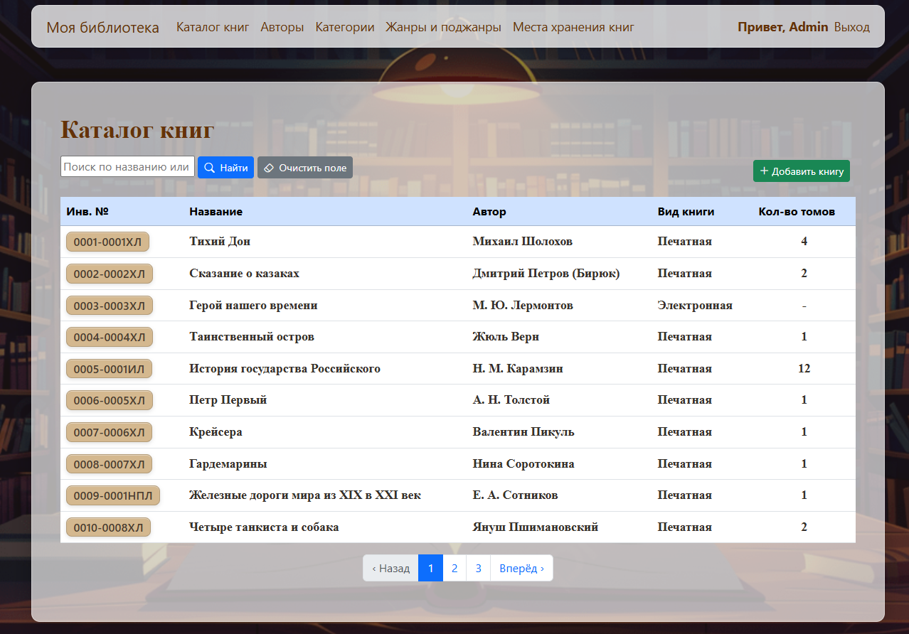
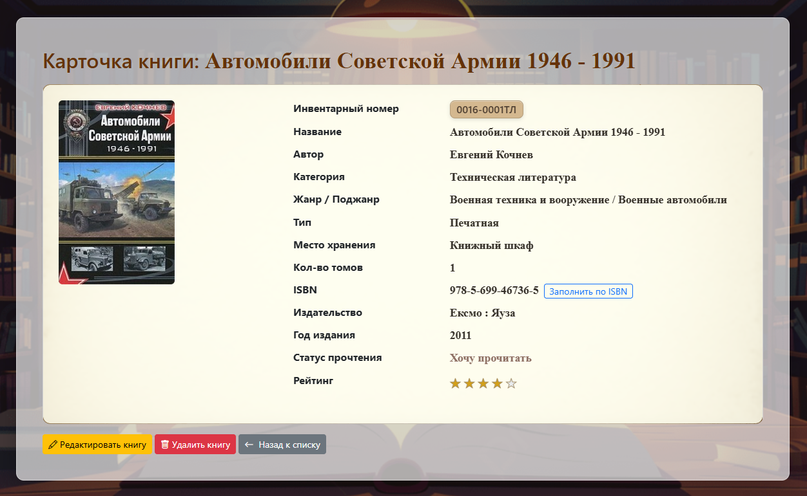

# Моя библиотека
Веб-приложение для ведения каталога печатных и электронных книг
## 📖 О проекте
Моя библиотека — это веб-приложение, которое помогает каталогизировать домашнюю библиотеку печатных или электронных книг с распределением их по категориям и жанрам, с присвоением инвентарных номеров, позволяющих вести учет книг и дающих возможность маркирования оригиналов. Приложение имеет своей целью сделать максимально простое ведение домашней библиотеки без заполнения множества ненужных полей при добавлении книги, которое обычно встречается в аналогичных программах.
### Реализация
- .NET 10.0
- ASP.NET Core MVC 10.0
- Microsoft.EntityFrameworkCore 10.0.13
- Database Microsoft SQL Server 2025
- Bootstrap 5.3.3
- jQuery JavaScript Library 3.7.1

### Инструменты
- Visual Studio 2026
- SQL Server Management Studio 22.12.1

### Возможности
- Просмотр библиотеки
- Аутентификация для редактирования
- Добавление и редактирование книг с автоматическим присвоением инвентарного номера
- Добавление и редактирование авторов книг
- Добавление и редактирование мест хранения
- Добавление и редактирование категорий ("Художественная литература", "Учебная литература")
- Добавление и редактирование жанров и поджанров (жанр "Фантастика", поджанр "Научная фантастика")

### Архитектура
Проект построен по принципам **Clean Architecture** с разделением на слои:
```
──────────────────────────────────────────────────
                  DOMAIN LAYER                     
        Entities │ Enums │ Repositories			   
──────────────────────────────────────────────────
                APPLICATION LAYER                 
           Dtos │ Helpers │ Services              
──────────────────────────────────────────────────
              INFRASTRUCTURE LAYER                
    Configurations │ Models │ Repositories         
──────────────────────────────────────────────────
                WEB LAYER                         
       Controllers │ Models │ Views               
──────────────────────────────────────────────────
```
### Паттерны проектирования

- **MVC** — Models Views Controllers
- **Repository Pattern** — абстракция доступа к данным
- **Dependency Injection** — внедрение зависимостей
- **Strategy** — стратегия
- **Factory** — DI

## 🖥️ Скриншоты





## Автор
Dmitry
[dmikov71](https://github.com/dmikov71)
		